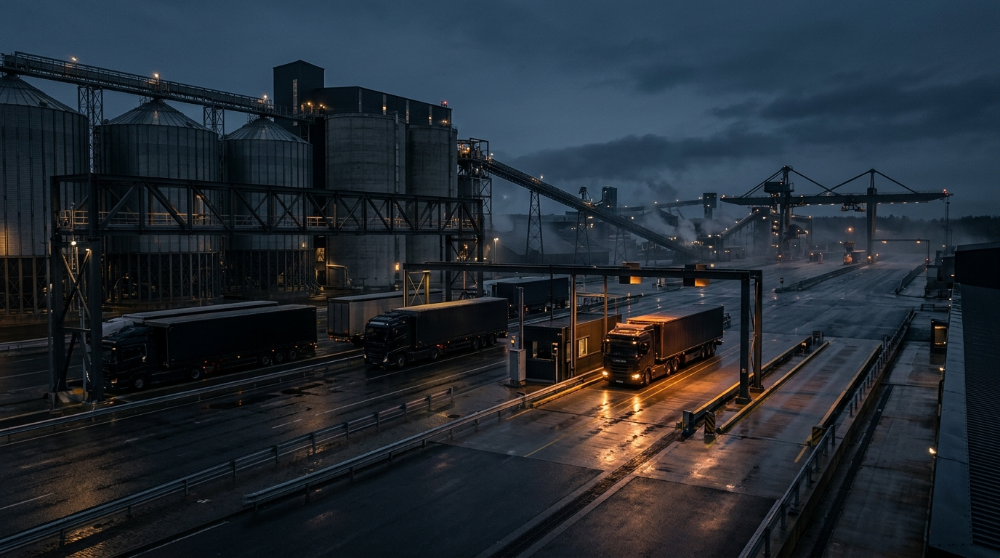

# TONAJ.B2B — Industrial Operating System & Weighbridge ERP

A unified, real-time operating system engineered for heavy bulk industrial facilities, eliminating fractured legacy software across weighbridges, dispatch, fleet, finance, and regulatory compliance.



---

## ⚡ Core Architecture

* **Frontend**: React 19, TypeScript, Vite, Tailwind CSS v4, Framer Motion (Natural cubic-bezier physics `[0.16, 1, 0.3, 1]`, Geist & Geist Mono typography).
* **Backend API Core**: Go (`server/main.go`) high-concurrency REST engine powering real-time weighbridge indicator telemetry, sector-specific operations, ministerial automation, and financial settlements.
* **Database / State**: Atomic thread-safe in-memory store with live JSON persistence.

---

## 🏭 7 Isolated Sector Desks

1. **Hazır Beton (Ready-Mix Concrete)**: Slump / priz süresi takibi, EBİS çip uyumu, silo basınç telemetrisi ve iade beton yönetimi.
2. **Taş Ocağı & Maden (Quarries & Mining)**: 42 Ton Karayolları otomatik çıkış bariyeri, 5-aks bağımsız tartım, MAPEG sevk fişi ve belediye rüsum tahakkuku.
3. **Demir Çelik (Iron & Steel)**: Haddehane teorik vs. gerçek ağırlık sapması, kütük takibi ve döküm numaralı etiketleme.
4. **Hurda Metal & Geri Dönüşüm (Scrap Metal & Recycling)**: Radyasyon kapı tarayıcısı, kamera mühürlü fire tespiti, ÇŞB MoTAT atık formu ve 9/10 KDV tevkifatı.
5. **Gümrüklü Antrepo (Bonded Warehousing)**: Gümrük BİLGE entegrasyonu, ardiye/demurraj sayaçları ve yeşil hat muayenesiz sevk.
6. **Kereste & Orman (Timber & Forestry)**: 3D Hacim ($m^3$) ➔ tonaj çevirici, kurutma fırını nem radarı ve OGM nakliye tezkeresi.
7. **Ağır Nakliye & Filo (Bulk Haulage Fleet)**: Boş dönüş (backhaul) pazaryeri, CAN-Bus mazot telemetrisi ve 24 saatte şantiye onaylı erken navlun.

---

## 🏛️ Ministerial & Regulatory Compliance Engine

* **T.C. Ulaştırma ve Altyapı Bakanlığı**: U-ETDS otomatik 4.2 saniyede sefer bildirimi.
* **Gelir İdaresi Başkanlığı (GİB)**: Karekodlu e-İrsaliye ve e-Fatura entegrasyonu.
* **T.C. Sanayi ve Teknoloji Bakanlığı**: ±%0.5 metroloji yasal tolerans hakemliği.
* **MAPEG**: e-Maden sicil ve maden sevk fişi otomasyonu.
* **Çevre, Şehircilik ve İklim Değişikliği Bakanlığı**: MoTAT atık formu entegrasyonu.

---

## 🚀 Quick Start

### 1. Start Go Core Server
```bash
cd server
go run main.go
# API Core starts at http://localhost:8080
```

### 2. Start Frontend UI
```bash
npm install
npm run dev
# Frontend starts at http://localhost:5173
```

### 3. Production Build
```bash
npm run build
```

---

## 📄 License
© 2026 TONAJ Teknoloji A.Ş. Tüm hakları saklıdır.
